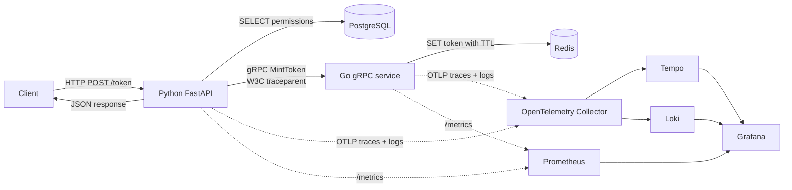

# GEANT SRE Lead Assignment - Observable Token Microservices

This repository extends the supplied FastAPI + Go starter into a containerized, Kubernetes-deployable demo platform with metrics, structured logs, distributed tracing, deployment hardening and operational documentation.

> **Scope and honesty:** this is an interview assignment / reference implementation, not a production-ready identity platform. Docker, Compose, Kubernetes, Prometheus, Grafana, Loki and Tempo are configured. Source tests, Docker builds, YAML parsing and Kustomize rendering have been validated locally; live Kubernetes failover, distributed traces and notification delivery require a real cluster and external integrations.
## 1. Architecture



**Request path:** the Python API validates the email, reads permissions from PostgreSQL using a bounded connection pool, calls the Go service with a finite gRPC deadline, and returns the generated opaque token. The Go service creates a 256-bit cryptographically-random token, stores `token:<token>` → normalized email in Redis with a bounded TTL, and returns the token. The demo `ValidateToken` RPC reads that mapping.

**Telemetry path:** W3C Trace Context is propagated from FastAPI to the PostgreSQL client and gRPC client, then through the Go gRPC server to Redis. Python and Go export OTLP traces and correlated logs to the Collector. The Collector sends traces to Tempo and logs to Loki. Prometheus scrapes application and Collector metrics; Grafana provisions the Prometheus, Loki and Tempo data sources and the platform dashboard.

## 2. What is included

| Area | Included implementation |
|---|---|
| Containers | Multi-stage Python and Go Dockerfiles, non-root runtime users, slim/distroless runtime, Compose stack |
| Kubernetes | Independent app Deployments, CloudNativePG PostgreSQL, Redis/Sentinel, Services, ConfigMaps, Secrets, probes, HPA, PDB and NetworkPolicies |
| Discovery/config | Kubernetes DNS service names, ConfigMaps for non-sensitive config, Secret references for passwords |
| Logging | JSON stdout logs with `trace_id` and `span_id`; OTLP log export to Loki through the Collector |
| Metrics | HTTP RED, gRPC RED, PostgreSQL pool usage/acquire latency/errors, Redis operation rate/errors/latency and Redis key count |
| Tracing | OpenTelemetry FastAPI, gRPC, psycopg2 and sanitised Redis spans; Tempo backend |
| Dashboard | Provisioned Grafana dashboard with request rate, errors, latency, pool saturation, Redis latency and token outcomes |
| Bonus | CI tests/builds, SLO-oriented Prometheus alert rules, HPAs, PDBs, and network policies |

## 3. Run locally with Docker Compose

Prerequisites: Docker Desktop / Docker Engine with Compose v2, and an available local port set (8000, 9090, 9091, 3000, 3100, 3200, 4317, 4318, 50051).

```bash
cp .env.example .env
# Put a different URL-safe random value in each password field; hex is URL-safe.
openssl rand -hex 32
# Edit .env with independent generated values before starting.
docker compose up --build -d
docker compose ps

# Legacy docker-compose alternative:
# docker-compose up --build -d
# docker-compose ps
```

Wait for PostgreSQL and Redis health checks and for both apps to start. The Go service starts its readiness endpoint even if Redis is temporarily unavailable; it remains unready until Redis responds. The Python readiness endpoint checks PostgreSQL and the Go gRPC channel.

Issue a token:

```bash
curl -sS -X POST http://localhost:8000/token \
  -H 'Content-Type: application/json' \
  -d '{"user_email":"alice@example.com"}' | jq
```

Expected shape (the token value is generated, so it will differ):

```json
{
  "token": "<64-character-hex-token>",
  "permissions": ["read:data", "write:data"],
  "expires_in": 3600
}
```

Seed users: `alice@example.com` has `read:data` and `write:data`; `bob@example.com` has `admin:users` and `read:data`. Unknown users return 404. Invalid input returns 422. Dependency failures map to 503/504 instead of leaking stack traces or returning misleading success responses.

Useful endpoints:

| Endpoint | Purpose |
|---|---|
| `http://localhost:8000/health/live` | Python process liveness |
| `http://localhost:8000/health/ready` | Python readiness (PostgreSQL + Go gRPC) |
| `http://localhost:8000/metrics` | Python Prometheus metrics |
| `http://localhost:9090/health/live` | Go process liveness |
| `http://localhost:9090/health/ready` | Go readiness (Redis ping) |
| `http://localhost:9090/metrics` | Go Prometheus metrics |
| `http://localhost:9091` | Prometheus UI |
| `http://localhost:3000` | Grafana UI (credentials from `.env`) |
| `http://localhost:3200` | Tempo HTTP API |
| `http://localhost:3100/ready` | Loki readiness endpoint |

The Grafana dashboard is provisioned automatically under **Dashboards → SRE → SRE - Token Platform Health**.

## 4. Demonstrate observability

### Metrics

Prometheus scrapes every 15 seconds. The Grafana dashboard includes Python API rate and 5xx ratio, p50/p95 HTTP latency, Go gRPC request rate by method/status, PostgreSQL pool utilisation and acquisition latency, Redis operation p95, Redis pool timeouts, token outcomes, Redis database key count and database query errors.

You can also query Prometheus directly:

```promql
sum by (route) (rate(http_server_requests_total{job="python-token-service"}[5m]))

sum(rate(http_server_requests_total{job="python-token-service",status_code=~"5.."}[5m]))
/
clamp_min(sum(rate(http_server_requests_total{job="python-token-service"}[5m])), 0.001)

histogram_quantile(0.95,
  sum by (le) (rate(http_server_request_duration_seconds_bucket{job="python-token-service"}[5m])))

db_pool_connections_in_use / db_pool_connections_max

histogram_quantile(0.95,
  sum by (le, operation) (rate(redis_operation_duration_seconds_bucket{job="go-token-service"}[5m])))
```

### Logs and request correlation

Generate a new request using the `curl` command above. In Grafana → Explore → Loki, query:

```logql
{service_name="python-token-service"} |= "token_issued"
{service_name="go-token-service"} |= "token_minted"
```

Open the Python request log and copy its `trace_id`. Search that exact trace ID in both services using Loki structured metadata filters, for example `{service_name="python-token-service"} | trace_id="<trace-id>"` and `{service_name="go-token-service"} | trace_id="<trace-id>"`. The request should correlate with the Go service log. Never log the raw token or email address.

### End-to-end trace

In Grafana → Explore → Tempo, search by service `python-token-service`, or use the trace ID from a Python request log. A successful request should show the FastAPI server span, PostgreSQL query/client span, gRPC client and Go server spans, and Redis `SET` span. If the spans are missing, check that both app containers have `OTEL_EXPORTER_OTLP_ENDPOINT=http://otel-collector:4317`, the Collector is healthy, and its Tempo/Loki exporters can reach their backends.

## 5. Deploy to Kubernetes

The manifests use Kustomize in `k8s/base`. Generated ConfigMaps read the checked-in copies under `k8s/base/config-files`; run `./scripts/sync-k8s-config.sh` after changing the canonical configs under `observability/` or `database/`. They assume a cluster with a default StorageClass, a metrics-server for HPA, a CNI that enforces NetworkPolicies, and (for external HTTP access) an Ingress controller in namespace `ingress-nginx`.

1. Build and push images to a registry reachable by the cluster. Replace `ghcr.io/your-org` in the manifests / `k8s/base/kustomization.yaml` with your registry and version.

```bash
docker build -t ghcr.io/your-org/sre-python-service:1.0.0 ./python-service
docker build -t ghcr.io/your-org/sre-go-service:1.0.0 ./golang-service
docker push ghcr.io/your-org/sre-python-service:1.0.0
docker push ghcr.io/your-org/sre-go-service:1.0.0
```

2. Create the namespace and a real Secret. Do not commit the resulting `k8s/secrets.yaml`.

```bash
kubectl apply -f k8s/base/namespace.yaml
cp k8s/secrets.example.yaml k8s/secrets.yaml
# Replace all placeholder passwords with separate URL-safe random secrets (e.g. openssl rand -hex 32).
kubectl apply -f k8s/secrets.yaml
```

3. Apply the platform.

```bash
kubectl apply -k k8s/base
kubectl -n sre-platform get pods,svc,pvc,hpa
kubectl -n sre-platform get events --sort-by=.lastTimestamp
```

4. Port-forward for the demo:

```bash
kubectl -n sre-platform port-forward svc/python-service 8000:8000
kubectl -n sre-platform port-forward svc/grafana 3000:3000
kubectl -n sre-platform port-forward svc/prometheus 9091:9090
```

Run the same `curl` request against `http://localhost:8000/token`. Grafana admin credentials come from the Secret. The manifests provide internal Services; an HTTPS Ingress / Gateway and certificate are intentionally environment-specific and must be configured before public exposure.

**Image loading with kind:** when using a local kind cluster rather than a registry, build the two images locally and run `kind load docker-image ... --name <cluster>` for both image tags; use `imagePullPolicy: IfNotPresent` as configured.

## 6. Tests and CI

```bash
cd python-service
python -m pip install -r requirements-dev.txt
pytest -q
cd ../golang-service
go test ./...
go vet ./...
```

The GitHub Actions workflow runs unit tests, Go vet, Docker builds, Compose integration smoke tests, Kustomize/kubeconform validation and filesystem vulnerability scanning. Container publication, SBOM, signing and live cluster tests require repository and platform credentials.

## 7. Additional SRE hardening

The implementation now includes the following review improvements:

- **Independent deployment roots:** `k8s/apps/python-service`, `k8s/apps/go-service`, and `k8s/platform` provide separate Kustomize reconciliation units. The Argo CD example uses separate Applications. The legacy `k8s/base` remains a convenient whole-platform demo deployment.
- **ConfigMap rollouts:** generated ConfigMaps use content-hash suffixes. Python or observability configuration changes can therefore update the relevant Pod template without disabling Kustomize's normal rollout behaviour.
- **Pod placement:** Python and Go Deployments include preferred zone/node topology spreading and pod anti-affinity. These are soft defaults; production clusters should add failure-domain capacity and, if required, a hard zone policy.
- **Network isolation:** the namespace uses default-deny ingress and egress policies with explicit application, DNS, Prometheus, OTLP, PostgreSQL, Redis and telemetry-backend flows. Test the rules against the actual CNI.
- **Redis infrastructure telemetry:** a Redis exporter is included in Compose and Kubernetes, and Prometheus scrapes it in both environments.
- **Optional gRPC mTLS:** Python and Go support certificate-based TLS when `GRPC_TLS_*` values and mounted certificates are configured. The local demo remains plaintext for compatibility. Production should require mTLS or an approved service-mesh identity model.
- **Release validation:** CI validates Kustomize rendering and Kubernetes schemas, in addition to Python tests, Go tests/vet and container builds.

Remaining production work is explicitly documented rather than hidden:

- **HA PostgreSQL:** install CloudNativePG with `make cnpg-install`, create `k8s/secrets.yaml`, and apply `k8s/platform`. The application uses the generated `postgres-rw` Service.
- **HA Redis:** the platform creates three Redis data Pods and three Sentinel Pods. The Go service resolves the Sentinel primary during startup and reconnects on failover.
- **GitOps environments:** `k8s/overlays/dev`, `staging`, and `production` provide environment-specific namespaces, replica counts, and image tags. `k8s/argocd-application.example.yaml` contains corresponding Argo CD Applications.
- **Database migrations:** `k8s/base/database-migration.yaml` runs `001_initial.sql` as a controlled Job before application rollout validation.
- **Alert delivery:** Prometheus sends firing alerts to Alertmanager. Replace the placeholder webhook in `observability/alertmanager/alertmanager.yml` with the approved notification integration.

Remaining production work:

- Obtain and configure CloudNativePG, backup object storage, restore credentials and retention.
- Test PostgreSQL switchover/failover and Redis Sentinel promotion.
- Integrate an external secret manager and workload certificates for production mTLS.
- Replace provisional notification routing and load-test HPA/connection budgets.

## 8. Important design decisions and limitations

- **Loki + Tempo + Prometheus:** open-source, local Compose friendly, and natively connected in Grafana. CloudWatch / managed observability is a sensible alternative in an AWS-only environment; see `docs/DESIGN_DECISIONS.md`.
- **One OpenTelemetry Collector:** centralises OTLP receiving, batching and exporting so applications do not need backend-specific code. The demo runs one Collector replica; production should use a scalable Deployment/DaemonSet topology with memory limits, persistent/retry queues where appropriate, and Collector self-monitoring.
- **PostgreSQL pooling:** the Python service reuses a bounded `ThreadedConnectionPool`; it does not establish a new database connection per API request. Pool size must be sized across all replicas against PostgreSQL `max_connections` and other clients.
- **gRPC channel reuse and deadlines:** the channel is created once per Python process and closed on shutdown. Each RPC has a finite timeout to prevent unbounded request/thread occupancy.
- **Redis is not a queue in this starter:** it is an expiring key/value token store. Therefore the code instruments real Redis command rate, errors, duration and DB key count. A “queue depth” gauge would be fabricated today. If a Redis list/stream or worker queue is added, implement `LLEN`/`XLEN`, consumer throughput, oldest-message age and processing duration for the actual queue.
- **Kubernetes data stores:** PostgreSQL uses CloudNativePG with three instances and Redis uses a three-node Redis/Sentinel topology. They still require operator installation, object-store backups, restore drills and production connection/capacity validation.
- **Secrets:** `k8s/secrets.example.yaml` is a template only. Use an external secret manager / CSI driver or External Secrets Operator, encryption at rest and rotation in production.

See `docs/ASSIGNMENT_COVERAGE.md`, `docs/IMPLEMENTATION_SUMMARY.md`, `docs/DESIGN_DECISIONS.md`, `docs/OPERATIONS.md`, `docs/DEMO_AND_INTERVIEW.md` and `docs/VALIDATION.md` for requirement mapping, concrete code changes, trade-offs, alert thresholds, live-demo script and validation boundary.

Before submission, run real PostgreSQL/Redis integration tests, gRPC contract tests and a Compose smoke test. For production mTLS, mount a CA and workload certificates into both gRPC Pods and set `GRPC_TLS_*` variables instead of using the local plaintext fallback.

For submission, replace mutable tags with immutable digests and publish both images to an accessible registry. In CI, add SBOM generation, provenance signing and image signing before merging to a protected release branch.
