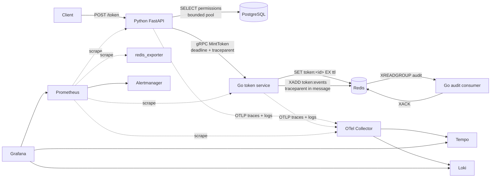
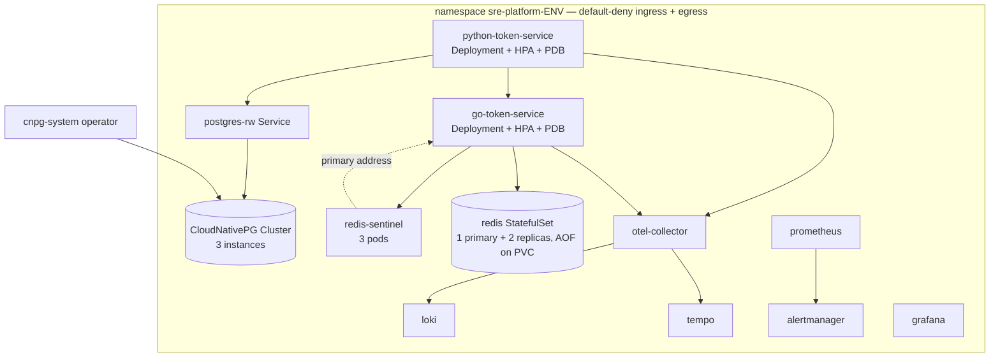

# GÉANT SRE Lead Assignment: Observable Token Microservices

A FastAPI service issues access tokens: it looks up a user's permissions in PostgreSQL and asks a Go gRPC
service to mint an opaque token, which Go stores in Redis with a TTL and records on an audit queue (a Redis
Stream). Both services are containerised, deployable with Docker Compose or Kubernetes (Kustomize +
Argo CD), and fully instrumented: RED and dependency metrics in Prometheus, JSON logs in Loki and
distributed traces in Tempo, all correlated by trace ID in Grafana.

> **Validation status.** Unit tests, strict Kustomize/schema validation (240 resources), Compose
> configuration, shell syntax, dashboard JSON and observability config checks passed. 
> See [docs/VALIDATION.md](docs/VALIDATION.md) for details and commands.

## 1. Architecture

### Request, queue and telemetry flow



1. **Python** validates the email, reads permissions through a bounded `ThreadedConnectionPool`, and calls Go
   over one reused gRPC channel with a per-call deadline. Unknown users return 404, invalid input 422, and
   dependency failures 503/504.
2. **Go** generates a 256-bit random token, stores `token:<token>` with the TTL, then publishes a
   `token_minted` audit event to the `token:events` stream. Publishing is best-effort: a failure is logged
   (`audit_event_publish_failed`) and never fails the mint.
3. **The audit consumer** (a goroutine in every Go replica, consumer group `audit`) reads events, records
   `token_audit_recorded`, and acknowledges them. Messages left pending by a crashed replica are reclaimed
   with `XAUTOCLAIM` after 30 s, which gives at-least-once delivery. The stream is capped at about 10,000 entries.
4. **W3C Trace Context** flows HTTP → psycopg2 → gRPC → Redis and continues *through the queue*: the
   producer injects `traceparent` into the message and the consumer span `audit.process` joins the same
   trace.
5. **Telemetry:** both services export OTLP traces and logs to the Collector, which forwards traces to Tempo
   and logs to Loki (`service_name` label, `trace_id` structured metadata). Prometheus scrapes the services,
   Collector, Redis exporter and (in Kubernetes) CloudNativePG. Grafana links Loki to Tempo through the
   `trace_id` field, and Tempo to Loki through "Logs for this span".

### Kubernetes topology



| Kustomize root | Contents |
|---|---|
| `k8s/platform` | Namespace, `platform-config`, CloudNativePG cluster, Redis + Sentinel, observability stack, NetworkPolicies. ConfigMaps are generated from the canonical files in `observability/` and `database/`, so Compose and Kubernetes cannot drift. |
| `k8s/apps/python-service`, `k8s/apps/go-service` | Each service's Deployment, Service, HPA and PDB. They can be reconciled independently. |
| `k8s/overlays/{dev,staging,production}` | One namespace per environment, plus image tags and environment patches. Dev and staging set lower CPU/memory requests and limits for apps, data stores and observability than the production base; dev uses the smallest profile. Dev also runs a single-node topology (1 PostgreSQL instance, soft anti-affinity) and caps app HPAs at 3 replicas; staging caps them at 5. Production retains the base resource sizing and raises `minReplicas` to 3. |
| `k8s/argocd-application.example.yaml` | An AppProject plus one Application per environment. Dev and staging sync automatically. Production is manual. |

Key Kubernetes behaviours:

- **PostgreSQL:** CloudNativePG creates the database and a least-privilege `app` owner, then runs
  `database/init.sql` and a read grant through `postInitApplicationSQLRefs`. Python reads `DATABASE_URL` from
  the operator-generated `postgres-app` Secret (`uri` key), which points at the `postgres-rw` primary Service.
- **Redis HA:** each Redis pod asks Sentinel for the current primary at startup and joins it as a replica.
  If it is the primary, it restarts from its AOF volume. Sentinel uses hostname announcements
  (`announce-hostnames`, `resolve-hostnames`), so pod IP changes do not break it. The Go client discovers the
  primary through Sentinel and follows failovers.
- **Network policy:** `default-deny` covers ingress and egress. Each workload then gets an explicit
  allowlist: DNS, app → dependency, app → Collector, Collector → Loki/Tempo, Prometheus → scrape targets,
  CNPG operator ↔ instances, and Kubernetes API access for Prometheus discovery and the CNPG instance manager.
- **Replica ownership:** HPAs own the replica count (Deployments do not set `replicas`), and PDBs protect
  voluntary disruptions.
- **Secrets:** `scripts/create-k8s-secrets.sh` creates `platform-secrets` (the Redis and Grafana passwords)
  with random values. CloudNativePG generates the database credentials. In production, use External Secrets
  Operator or a CSI secret store.

## 2. Repository layout

```text
python-service/          FastAPI API, Dockerfile, unit tests
golang-service/          gRPC token service, audit queue (audit_queue.go), Dockerfile, unit tests
protos/                  token.proto
database/init.sql        schema + seed users (used by Compose and CloudNativePG)
observability/           canonical Prometheus, alert rules (+ unit tests), Alertmanager, OTel Collector,
                         Loki, Tempo and Grafana provisioning/dashboard
k8s/                     platform, apps, overlays, Argo CD example
scripts/                 smoke test, trace/log validation, CNPG install, secrets, kind end-to-end test
docs/                    assignment coverage, design decisions, operations, demo guide, validation record
```

## 3. Run locally with Docker Compose

Prerequisites: Docker with Compose v2, plus free ports 8000, 9090, 9091, 9093, 3000, 3100, 3200, 4317, 4318
and 50051.

```bash
cp .env.example .env
# Replace every change-me-local-only value with its own random value, e.g. `openssl rand -hex 32`.
docker compose up --build -d --wait     # returns once health checks pass
./scripts/smoke-test.sh                 # liveness, readiness, token for alice, 404 for an unknown user
./scripts/validate-observability.sh     # proves one trace ID across Tempo and Loki (see section 4)
```

Issue a token yourself:

```bash
curl -sS -X POST http://localhost:8000/token \
  -H 'Content-Type: application/json' -d '{"user_email":"alice@example.com"}'
# {"token":"<64 hex chars>","permissions":["read:data","write:data"],"expires_in":3600}
```

The seed users are `alice@example.com` (`read:data`, `write:data`) and `bob@example.com` (`admin:users`,
`read:data`).

| URL | Purpose |
|---|---|
| `http://localhost:8000/health/live`, `/health/ready`, `/metrics` | Python liveness, readiness (PostgreSQL and the gRPC channel) and metrics |
| `http://localhost:9090/health/live`, `/health/ready`, `/metrics` | Go liveness, readiness (Redis ping) and metrics |
| `http://localhost:3000` | Grafana (`admin` / `GRAFANA_ADMIN_PASSWORD`). Dashboard: **SRE → SRE - Token Platform Health** |
| `http://localhost:9091` | Prometheus (targets, rules, alerts) |
| `http://localhost:9093` | Alertmanager |
| `http://localhost:3100`, `http://localhost:3200` | Loki and Tempo HTTP APIs |

Stop the stack with `docker compose down`, or add `--volumes` to also delete the data.

## 4. Observability walkthrough (the demo)

**One command proves correlation:** `./scripts/validate-observability.sh` generates its own W3C
`traceparent`, issues a token with it, and then requires two things:

1. Tempo returns that trace, containing both services and the `redis.set`, `redis.xadd` and `audit.process` spans.
2. A single Loki query returns log lines from **both** services for that trace ID:

```logql
{service_name=~"python-token-service|go-token-service"} | trace_id="<trace-id>"
```

**In Grafana:**

- **Explore → Loki**: run the query above, expand a log line and use the **TraceID** link to open the trace in Tempo.
- **Explore → Tempo**: search for service `python-token-service`. The trace shows FastAPI → PostgreSQL query →
  gRPC client → Go `MintToken` → `redis.set` → `redis.xadd`, followed by the asynchronous `audit.process` →
  `redis.xack`. Click **Logs for this span** to get the Loki lines for both services.
- **Dashboard** (the header links jump to Explore):
  - Python HTTP RED: rate, 5xx ratio, p50/p95.
  - Go gRPC RED: rate, server-error ratio, p50/p95.
  - The 1-hour availability SLI against the 99.9% target.
  - PostgreSQL pool: utilisation, acquire latency, errors.
  - Redis: command p95, pool timeouts, keys, and per-pod `redis_up` and role from `redis_exporter`.
  - Audit queue: depth (lag + pending), oldest pending age, processing p95, throughput.

Key metrics:

| Signal | Metric |
|---|---|
| HTTP RED | `http_server_requests_total{method,route,status_code}`, `http_server_request_duration_seconds` |
| gRPC RED | `grpc_server_requests_total{method,status}`, `grpc_server_request_duration_seconds` |
| DB pool | `db_pool_connections_in_use`, `db_pool_connections_max`, `db_pool_acquire_duration_seconds`, `db_pool_acquire_errors_total` |
| Redis client | `redis_operations_total{operation,status}`, `redis_operation_duration_seconds`, `redis_pool_timeouts_total` |
| **Queue depth** | `redis_stream_length`, `redis_stream_lag_messages` (not yet delivered), `redis_stream_pending_messages` (delivered), `redis_stream_oldest_pending_age_seconds` |
| **Queue processing time** | `queue_message_processing_duration_seconds`, `queue_messages_processed_total{status}` |

Alerting uses recording rules plus multi-window burn-rate alerts for the 99.9% SLO: a fast burn is 14.4× over
1 h and 5 m, and a slow burn is 6× over 6 h and 30 m. It also has latency alerts, `absent()` alerts for missing
targets, dependency alerts (DB pool, CNPG, Redis), queue backlog and stall alerts, and Collector export
failures. The rules are unit-tested in `observability/prometheus/alert-rules.test.yml`. See
[docs/OPERATIONS.md](docs/OPERATIONS.md) for thresholds and runbooks.

## 5. Run on Kubernetes

### One-command local cluster (kind)

Prerequisites: Docker Engine/VM with at least 6 GiB of memory and 4 CPUs, [kind](https://kind.sigs.k8s.io/) 0.24 or later
(its default CNI enforces NetworkPolicy), `kubectl` and `openssl`. The script refuses to reuse an existing
cluster and, by default, refuses to start while another kind cluster is running.

```bash
./scripts/kind-e2e.sh
# Use only with enough Docker memory if another kind cluster must stay running:
ALLOW_PARALLEL_KIND_CLUSTER=1 KIND_CLUSTER=sre-token-e2e ./scripts/kind-e2e.sh
# KEEP_CLUSTER=1 keeps the newly-created test cluster afterwards.
```

The script does the following:

1. Creates the cluster, builds both images and loads them into kind.
2. Installs CloudNativePG, creates the secrets and applies `k8s/overlays/dev`.
3. Waits for PostgreSQL and every workload.
4. Runs the smoke test and the trace/log validation, then checks that every Prometheus target is up and an
   Alertmanager is discovered.
5. Runs a Redis failover drill: it hangs the primary for 20 s, requires Sentinel to promote a replica, issues
   tokens again, and checks that the old primary rejoins as a replica.

### Step by step (any cluster)

```bash
# 1. Images: build, push, and set the tag in the overlay (`images:` in k8s/overlays/<env>/kustomization.yaml)
docker build -t ghcr.io/your-org/sre-python-service:1.0.0 python-service
docker build -t ghcr.io/your-org/sre-go-service:1.0.0 golang-service

# 2. Operator and secrets
./scripts/install-cnpg.sh
./scripts/create-k8s-secrets.sh sre-platform-dev

# 3. Apply. The platform reads ../../observability, hence the load restrictor flag.
kubectl kustomize --load-restrictor LoadRestrictionsNone k8s/overlays/dev | kubectl apply --server-side -f -
kubectl -n sre-platform-dev get cluster,pods,svc,hpa

# 4. Access
kubectl -n sre-platform-dev port-forward svc/python-service 8000:8000 &
kubectl -n sre-platform-dev port-forward svc/grafana 3000:3000 &
./scripts/smoke-test.sh
```

The cluster needs a default StorageClass, metrics-server for the HPAs, and a CNI that enforces NetworkPolicy.
For external access, add an Ingress or Gateway with TLS in the `ingress-nginx` namespace, which the
NetworkPolicies already allow.

**Argo CD:** apply `k8s/argocd-application.example.yaml` after changing `repoURL`, and set
`kustomize.buildOptions: --load-restrictor LoadRestrictionsNone` in `argocd-cm` (this is a repo-server
setting, not an Application field). Dev and staging self-heal. Production syncs manually, from an image tag
promoted by CI.

## 6. Tests and CI

Run Python tests in a virtual environment and then execute the static validation targets:

```bash
python3 -m venv .venv
. .venv/bin/activate
python -m pip install -r python-service/requirements-dev.txt
make test                         # Python tests + Go formatting, vet and race tests
(cd golang-service && go mod tidy -diff)
make validate-config              # needs promtool, amtool and otelcol-contrib on PATH
python -m json.tool observability/grafana/dashboards/sre-token-platform.json >/dev/null
make k8s-validate                  # renders every root; strict schemas include CNPG and Argo CD
```

For the runtime flows, first validate the Compose file, then start the stack and run the smoke and
trace/log-correlation checks:

```bash
docker compose config --quiet       # use `docker-compose` instead if that is your installed command
cp .env.example .env                 # replace the example values with local secrets
docker compose up --build -d --wait --wait-timeout 180
./scripts/smoke-test.sh
./scripts/validate-observability.sh
docker compose down --remove-orphans
```

For the full Kubernetes deployment and Redis failover test (requires Docker, kind 0.24+, kubectl and
openssl):

```bash
make kind-e2e                       # creates and later deletes only its own kind cluster
```

`.github/workflows/ci.yml` runs these jobs:

| Job | What it checks |
|---|---|
| `python`, `golang` | Unit tests, `go mod tidy -diff`, gofmt, vet, race tests |
| `observability-config` | Every config, validated with the same Prometheus, Alertmanager and Collector images the stack deploys |
| `k8s-validation` | Strict schema validation of every Kustomize root |
| `containers` | hadolint, image build and a Trivy image scan for each service |
| `integration` | Compose up, smoke test, and Tempo + Loki correlation |
| `kind-e2e` | The kind end-to-end and failover test |
| `security` | Trivy filesystem and dependency scan |

## 7. Design decisions (summary)

Full reasoning is in [docs/DESIGN_DECISIONS.md](docs/DESIGN_DECISIONS.md).

- **Prometheus + Loki + Tempo + Grafana behind one OTel Collector.** It is open source, runs the same in
  Compose and Kubernetes, and Grafana links all three natively. The applications only speak OTLP.
- **Redis Stream for the audit queue.** Consumer groups, acknowledgements, pending-entry tracking and replay
  give measurable depth (lag + pending), oldest-message age and processing time. A Redis List would need
  hand-written acknowledgement and retry logic.
- **Sanitised manual Redis spans.** Only the operation name is recorded, never keys or values, which contain
  tokens.
- **Readiness, not liveness, reflects dependencies.** A PostgreSQL or Redis outage removes pods from
  endpoints instead of restart-looping them.
- **Fail closed on TLS misconfiguration.** If `GRPC_TLS_*` is set but the certificates are invalid, the Go
  service exits rather than silently serving plaintext. With no TLS settings it runs the local plaintext demo
  and logs `grpc_transport=plaintext_demo` at startup.
- **Kustomize over Helm.** The rendered output stays inspectable for a small two-service platform. Generated
  ConfigMaps carry content hashes, so a config change rolls out the pods that use it.
- **No service mesh.** Istio or Linkerd would add sidecars and an operational burden that this two-service
  system doesn't need. mTLS is supported at the application level instead.

## 8. Production readiness: what remains

These require real infrastructure or organisational decisions, and are not missing code:

- CloudNativePG backups to object storage with PITR, restore drills, and Redis persistence and memory policy
  sized from load tests.
- Mandatory mTLS between Python and Go with workload certificates and rotation, plus an external secret manager.
- A real notification route: replace the `example.invalid` webhook in
  `observability/alertmanager/alertmanager.yml`, then test a page end to end.
- Ingress or Gateway with TLS, authentication and rate limiting; images pinned by digest, signed, with SBOM
  and provenance.
- Load tests to validate HPA thresholds, pool sizes (pods × `DB_POOL_MAX` against `max_connections`) and
  SLO targets.
- Observability backends in HA/microservices mode with object storage, retention and a trace sampling policy.

Further reading: [assignment coverage](docs/ASSIGNMENT_COVERAGE.md) ·
[design decisions](docs/DESIGN_DECISIONS.md) · [operations and SLOs](docs/OPERATIONS.md) ·
[demo guide](docs/DEMO_AND_INTERVIEW.md) · [validation record](docs/VALIDATION.md)
